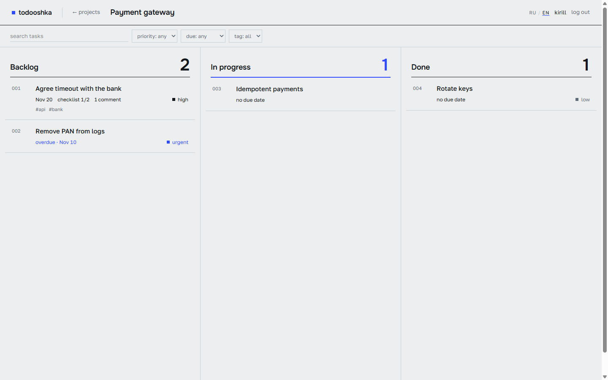

# Todooshka

A self-hosted Kanban board for personal work projects. The backend is Rust (axum + SQLite),
the interface is React + TypeScript. One binary serves both the API and the SPA.



[](https://github.com/vasilchenkome/todooshka/actions/workflows/ci.yml)
[](LICENSE)

## What it is

Todooshka is built for one person who wants a small, fast board for their own projects:
no accounts, no sign-up, no cloud, no workspace administration. You run it yourself,
create one user, and keep the data in a single SQLite file.

It is intentionally **not**:

- a multi-user or team product;
- a SaaS with public registration;
- a Jira/Trello replacement with integrations, workflows, or reporting;
- a mobile app — the web interface works on a phone and tablet, but there is no native client.

## Features

- Projects: create, rename, archive, restore; task counters per column.
- Board: Backlog / In Progress / Done, drag and drop with a mouse or a finger, reordering.
- Planning: calendar due date, four priorities, time estimate in minutes.
- Checklists with progress on the card.
- Tags, text search, filters by priority, due date, and tag; filter state lives in the URL.
- Comments with editing and deletion.
- Attachments up to 10 MB, at most 10 per task. Files are stored in SQLite, so they are included
  in a regular database backup.
- Russian and English interface; the language is detected from the browser and can be switched
  in the header.
- Single-user authentication with a password and an HttpOnly session cookie.
- The application never exposes its internal port when deployed with the bundled Caddy setup.

## Stack

| Layer | Choice |
|---|---|
| Backend | Rust 1.99+, axum, tokio, SQLite via sqlx |
| Frontend | React 19, TypeScript, Vite, Tailwind CSS 4 |
| State and forms | TanStack Query, zod |
| Drag and drop | dnd-kit |
| Deployment | Docker Compose, Caddy with automatic HTTPS |

## Architecture

The backend is split into five crates. Dependencies point inward; `domain` and `application`
know nothing about axum, sqlx, tokio, or the HTTP wire format.

| Crate | Responsibility |
|---|---|
| `todooshka-domain` | entities, invariants, status transitions, ordering rules |
| `todooshka-app` | use cases and ports required from infrastructure |
| `todooshka-sqlite` | repositories, transactions, migrations |
| `todooshka-http` | axum router, DTOs, middleware, embedded SPA |
| `todooshka` | composition root, configuration, CLI, server startup |

`frontend/` is a Vite application. In development Vite proxies `/api` to the backend; in a
release build the frontend assets are embedded into the Rust binary.

The boundary rule is checked in CI and locally:

```bash
./scripts/check-boundaries.sh
```

## Quick start

Requirements: Rust 1.99 or newer, Node.js 22 or newer, npm.

```bash
# 1. Create the only user (runs against the same SQLite file)
cargo run -- user add -u kirill

# 2. Backend on http://127.0.0.1:8080
cargo run

# 3. Frontend on http://localhost:5173
cd frontend
npm install
npm run dev
```

The backend uses `sqlite://todooshka.db` by default. The schema prefix is required: a bare file
path is rejected at startup instead of being silently treated as a database name.

## Configuration

| Variable | Default | Purpose |
|---|---|---|
| `BIND_ADDR` | `127.0.0.1:8080` | Server address; in a container use `0.0.0.0:8080` |
| `DATABASE_URL` | `sqlite://todooshka.db` | SQLite file; in a container `sqlite:///data/todooshka.db` |
| `COOKIE_SECURE` | `false` | `true` when served over HTTPS: the session cookie gets `Secure` |
| `RUST_LOG` | `info` | Log level |
| `LOG_FORMAT` | `text` | `json` for structured container logs |

## CLI

The account is created from the CLI, against the same database the server uses:

```bash
todooshka user add -u kirill      # password is read twice, hidden
todooshka user passwd -u kirill   # changing it revokes all sessions
todooshka user list
todooshka healthcheck             # 0 when /api/health/ready returns 200
todooshka backup ./copy.db        # VACUUM INTO + integrity_check
```

For scripts and containers, pass the password as one line:
`todooshka user add -u kirill --password-stdin`.

Everything except `/api/health`, `/api/health/ready`, and `/api/auth/login` requires a session
cookie (`HttpOnly`, `SameSite=Lax`, 30 days).

## Tests

```bash
cargo fmt --all --check
cargo clippy --workspace --all-targets -- -D warnings
cargo test --workspace
./scripts/check-boundaries.sh
cd frontend && npm run build
```

## Docker and deployment

The release image contains the API and the interface; no separate nginx is needed. GitHub
Actions builds the image on every push to `main` and publishes it to GHCR:

```text
ghcr.io/vasilchenkome/todooshka:latest
ghcr.io/vasilchenkome/todooshka:sha-<short-commit>
ghcr.io/vasilchenkome/todooshka:<version-from-Cargo.toml>
```

The production compose file runs two services: the application and Caddy. Caddy owns ports
80 and 443, obtains a Let's Encrypt certificate automatically, redirects HTTP to HTTPS, and
proxies to the application over the internal Docker network. The application port is not
published.

```bash
git clone git@github.com:vasilchenkome/todooshka.git /opt/todooshka
cd /opt/todooshka

cat > .env <<'EOF'
TODOOSHKA_DOMAIN=todo.example.org
TODOOSHKA_TAG=latest
COOKIE_SECURE=true
EOF

docker compose pull
docker compose up -d
docker compose ps            # app should become healthy

docker compose exec app todooshka user add -u kirill
```

### Update and rollback

```bash
git pull
docker compose pull
docker compose up -d

# roll back to a known image
TODOOSHKA_TAG=sha-1a2b3c4 docker compose pull
TODOOSHKA_TAG=sha-1a2b3c4 docker compose up -d
```

Check the running image with `docker compose ps` and
`docker inspect --format '{{.Config.Image}}' todooshka-app-1`.

### Backup and restore

Backups use `VACUUM INTO` and verify the copy with `PRAGMA integrity_check`. An existing file
is never overwritten. Data lives in the `todooshka-data` volume (`/data/todooshka.db`); SQLite
WAL files are part of the same volume.

```bash
docker compose exec app todooshka backup /data/backups/todooshka-$(date +%F-%H%M).db
```

Restore only while the application is stopped:

```bash
docker compose stop app
docker compose run --rm --entrypoint sh app -c 'rm -f /data/todooshka.db-wal /data/todooshka.db-shm'
docker compose cp todooshka-2026-11-14-1200.db app:/data/todooshka.db
docker compose start app
docker compose exec app todooshka user list   # database opens, users are present
```

### HTTPS

Caddy is part of the normal `docker compose up -d`. It needs ports 80 and 443 open and a DNS
A record pointing to the VM. Set `TODOOSHKA_DOMAIN` in `.env`; Caddy handles certificate
issuance and renewal. The application listens on `app:8080` only inside the Compose network.

## Security notes

- One account, no registration, no password reset by email.
- Passwords are hashed with Argon2id; only a SHA-256 hash of the session token is stored.
- The session cookie is `HttpOnly`, `SameSite=Lax`, and `Secure` under HTTPS.
- Login attempts are rate-limited per username.
- Attachments are served only to an authenticated session, with `Content-Disposition` and
  `X-Content-Type-Options: nosniff`.
- TLS is terminated by Caddy; the application port is not exposed to the internet.

To report a vulnerability, read [SECURITY.md](SECURITY.md). Please do not open a public issue
for an unfixed security problem.

## Limitations and roadmap

Todooshka deliberately stays small:

- one user per installation;
- no real-time collaboration or shared workspaces;
- no Jira/Trello/Git integrations;
- no time tracking, recurring tasks, or reporting;
- no mobile apps.

Possible future work: more locales, import/export, and better keyboard navigation are reasonable
next steps.

## Contributing

See [CONTRIBUTING.md](CONTRIBUTING.md). Run the checks above before opening a pull request.

## License

MIT. See [LICENSE](LICENSE).

---

Русская версия: [README.ru.md](README.ru.md).
