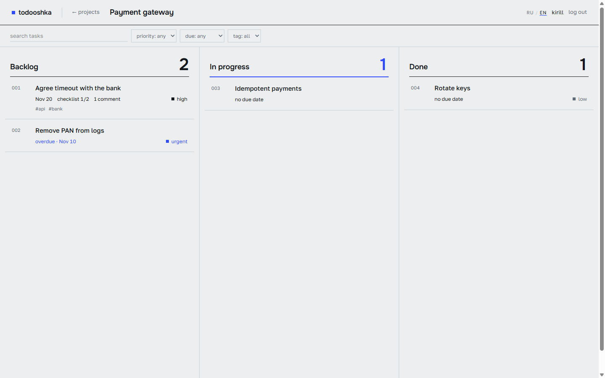

# Todooshka

Личный self-hosted Kanban для рабочих проектов. Бэкенд — Rust (axum + SQLite), интерфейс —
React + TypeScript. Один бинарь отдаёт и API, и SPA.



[](https://github.com/vasilchenkome/todooshka/actions/workflows/ci.yml)
[](LICENSE)

## Что это

Todooshka — маленькая быстрая доска для одного человека и его собственных проектов: без
регистрации, облака и администрирования рабочих пространств. Приложение запускается у себя,
пользователь создаётся один раз, данные лежат в одном файле SQLite.

Это сознательно **не**:

- многопользовательский командный продукт;
- SaaS с публичной регистрацией;
- замена Jira/Trello с интеграциями, процессами и отчётами;
- мобильное приложение — веб-интерфейс работает на телефоне и планшете, отдельного клиента нет.

## Возможности

- Проекты: создание, переименование, архив и возврат, счётчики задач по колонкам.
- Доска: «Бэклог / В работе / Готово», drag&drop мышью и пальцем, перенос и сортировка.
- Планирование: календарный срок, четыре приоритета, оценка в минутах.
- Чек-листы с прогрессом на карточке.
- Теги, поиск по тексту, фильтры по приоритету, сроку и тегу; состояние фильтров в URL.
- Комментарии с правкой и удалением.
- Вложения до 10 МБ, не больше 10 на задачу; файлы лежат в SQLite и попадают в обычный
  бэкап базы.
- Интерфейс на русском и английском; язык определяется по браузеру и переключается в шапке.
- Один пользователь, вход по паролю, HttpOnly cookie сессии.
- В штатном Docker-развёртывании внутренний порт приложения не публикуется наружу.

## Стек

| Слой | Выбор |
|---|---|
| Бэкенд | Rust 1.99+, axum, tokio, SQLite через sqlx |
| Фронтенд | React 19, TypeScript, Vite, Tailwind CSS 4 |
| Состояние и формы | TanStack Query, zod |
| Drag and drop | dnd-kit |
| Развёртывание | Docker Compose, Caddy с автоматическим HTTPS |

## Архитектура

Бэкенд разделён на пять крейтов. Зависимости направлены внутрь: `domain` и `application`
не знают про axum, sqlx, tokio и формат HTTP.

| Крейт | Ответственность |
|---|---|
| `todooshka-domain` | сущности, инварианты, переходы статусов, правила порядка |
| `todooshka-app` | сценарии и порты к инфраструктуре |
| `todooshka-sqlite` | репозитории, транзакции, миграции |
| `todooshka-http` | axum-роутер, DTO, middleware, встроенная SPA |
| `todooshka` | composition root, конфигурация, CLI, запуск сервера |

`frontend/` — приложение на Vite. В разработке Vite проксирует `/api` на бэкенд, в release-
сборке файлы фронтенда вшиваются в Rust-бинарь.

Границы проверяются локально и в CI:

```bash
./scripts/check-boundaries.sh
```

## Быстрый старт

Нужны Rust 1.99+, Node.js 26+ и npm.

```bash
# 1. Создать единственного пользователя (та же база SQLite)
cargo run -- user add -u demo

# 2. Бэкенд на http://127.0.0.1:8080
cargo run

# 3. Фронтенд на http://localhost:5173
cd frontend
npm install
npm run dev
```

По умолчанию бэкенд использует `sqlite://todooshka.db`. Префикс схемы обязателен: голый путь
к файлу отклоняется на старте, а не превращается молча в имя базы.

## Конфигурация

| Переменная | По умолчанию | Назначение |
|---|---|---|
| `BIND_ADDR` | `127.0.0.1:8080` | Адрес сервера; в контейнере `0.0.0.0:8080` |
| `DATABASE_URL` | `sqlite://todooshka.db` | Файл SQLite; в контейнере `sqlite:///data/todooshka.db` |
| `COOKIE_SECURE` | `false` | `true` за HTTPS: cookie получает флаг `Secure` |
| `RUST_LOG` | `info` | Уровень логов |
| `LOG_FORMAT` | `text` | `json` для структурированных логов контейнера |

## CLI

Учётная запись создаётся из CLI и работает с той же базой, что и сервер:

```bash
todooshka user add -u demo      # пароль вводится скрыто, дважды
todooshka user passwd -u demo   # смена пароля отзывает все сессии
todooshka user list
todooshka healthcheck             # 0, если /api/health/ready отвечает 200
todooshka backup ./copy.db        # VACUUM INTO + integrity_check
```

Для скриптов и контейнера пароль передаётся одной строкой:
`todooshka user add -u demo --password-stdin`.

Всё, кроме `/api/health`, `/api/health/ready` и `/api/auth/login`, требует cookie сессии
(`HttpOnly`, `SameSite=Lax`, 30 дней).

## Проверки

```bash
cd frontend && npm ci && npm run build && cd ..
cargo fmt --all --check
cargo clippy --workspace --all-targets -- -D warnings
cargo test --workspace
./scripts/check-boundaries.sh
```

## Docker и развёртывание

Release-образ содержит API и интерфейс; отдельный nginx не нужен. GitHub Actions собирает
образ при каждом пуше в `main` и публикует в GHCR:

```text
ghcr.io/vasilchenkome/todooshka:latest
ghcr.io/vasilchenkome/todooshka:sha-<короткий-коммит>
ghcr.io/vasilchenkome/todooshka:<версия-из-Cargo.toml>
```

В боевом compose два сервиса: приложение и Caddy. Caddy занимает порты 80 и 443, сам получает
сертификат Let's Encrypt, перенаправляет HTTP на HTTPS и проксирует запросы к приложению по
внутренней сети Docker. Порт приложения наружу не публикуется.

```bash
git clone git@github.com:vasilchenkome/todooshka.git /opt/todooshka
cd /opt/todooshka

cat > .env <<'EOF'
TODOOSHKA_DOMAIN=todo.example.org
TODOOSHKA_TAG=latest
COOKIE_SECURE=true
EOF

docker compose pull
docker compose up -d
docker compose ps            # app должен стать healthy

docker compose exec app todooshka user add -u demo
```

### Автодеплой по тегу

Прод обновляется только по версионным тегам. Тег должен совпадать с версией в
`Cargo.toml`; `release.yml` прогоняет тесты, собирает и публикует образ, затем деплоит его
по SSH.

```bash
# после изменения версии в Cargo.toml (и frontend/package.json)
git commit -am "release: 0.2.0"
git tag -a v0.2.0 -m "Todooshka 0.2.0"
git push origin main
git push origin v0.2.0
```

Деплой идёт под отдельным пользователем `deploy` с forced command: перед обновлением
снимается backup базы, после запуска проверяется health и HTTPS, при ошибке скрипт
возвращает предыдущий тег. В проде не используется `latest`; `TODOOSHKA_TAG` в `.env`
на VM фиксируется на задеплоенной версии. После успешного деплоя workflow публикует GitHub
Release из соответствующей секции `CHANGELOG.md`.

### Ручное обновление и откат

```bash
git pull
docker compose pull
docker compose up -d

# откат на известный образ
TODOOSHKA_TAG=sha-1a2b3c4 docker compose pull
TODOOSHKA_TAG=sha-1a2b3c4 docker compose up -d
```

Какая сборка запущена: `docker compose ps` и
`docker inspect --format '{{.Config.Image}}' todooshka-app-1`.

### Бэкап и восстановление

Копия снимается через `VACUUM INTO` и проверяется `PRAGMA integrity_check`; существующий файл
не перезаписывается. Данные лежат в томе `todooshka-data` (`/data/todooshka.db`), WAL-файлы
SQLite — в том же томе.

```bash
docker compose exec app todooshka backup /data/backups/todooshka-$(date +%F-%H%M).db
```

Восстановление — только на остановленном сервисе:

```bash
docker compose stop app
docker compose run --rm --entrypoint sh app -c 'rm -f /data/todooshka.db-wal /data/todooshka.db-shm'
docker compose cp todooshka-2026-11-14-1200.db app:/data/todooshka.db
docker compose start app
docker compose exec app todooshka user list   # база читается, пользователи на месте
```

### HTTPS

Caddy входит в обычный `docker compose up -d`. Ему нужны открытые порты 80 и 443 и DNS-запись
A домена на IP VM. Домен задаётся в `.env` как `TODOOSHKA_DOMAIN`; сертификат Caddy получает и
продлевает сам. Приложение слушает `app:8080` только внутри сети Compose.

## Безопасность

- Один пользователь, без регистрации и сброса пароля по почте.
- Пароли хешируются Argon2id; в базе хранится только SHA-256 от токена сессии.
- Cookie сессии: `HttpOnly`, `SameSite=Lax`, `Secure` под HTTPS.
- Попытки входа ограничены по имени пользователя.
- Вложения отдаются только с валидной сессией, с `Content-Disposition` и
  `X-Content-Type-Options: nosniff`.
- TLS завершает Caddy; порт приложения не выставлен в интернет.

Об уязвимости — по правилам [SECURITY.md](SECURITY.md). Пожалуйста, не открывай публичный
issue до исправления.

## Ограничения и планы

Todooshka сознательно остаётся маленькой:

- один пользователь на установку;
- нет совместной работы и общих пространств;
- нет интеграций с Jira/Trello/Git;
- нет учёта времени, повторяющихся задач и отчётов;
- нет мобильных приложений.

Разумные следующие шаги: новые языки, импорт/экспорт и улучшенная навигация с клавиатуры.

## Участие

См. [CONTRIBUTING.md](CONTRIBUTING.md). Перед pull request прогони проверки выше.

## Журнал изменений

Release notes и заметные изменения — в [CHANGELOG.md](CHANGELOG.md).

## Лицензия

MIT. См. [LICENSE](LICENSE).

---

English version: [README.md](README.md).
